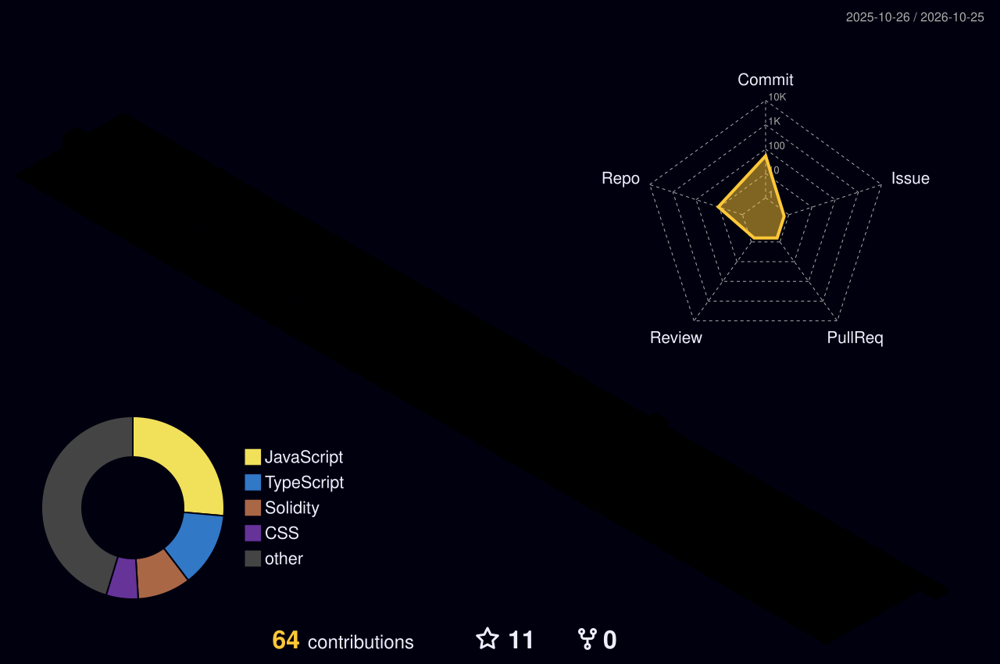

<!-- ░░░░░░░░░░░░░░░░░░░░ BANNER ░░░░░░░░░░░░░░░░░░░░ -->
<p align="center">
  
</p>

<!-- ░░░░░░░░░░░░░░░░░░░░ INTRO ░░░░░░░░░░░░░░░░░░░░ -->
<h1 align="center">
  
</h1>

<p align="center">
  
  
  
</p>


<!-- ░░░░░░░░░░░░░░░░░░░░ ABOUT ░░░░░░░░░░░░░░░░░░░░ -->
<h2 align="center"></h2>

<table>
<tr>
<td width="58%" valign="top">

```python
class Developer:
    def __init__(self):
        self.name = "Aaditya Gupta"
        self.role = "Full-Stack Developer and AI/ML enthusiast"
        self.skills = ["Python", "TypeScript", "React", "Node.js", "FastAPI"]
        self.learning = ["System Design", "Cloud", "GenAI"]

    def intro(self):
        print(f"Hi, I'm {self.name}, a {self.role}!")


me = Developer()
me.intro()
```

</td>
<td width="42%" valign="top">

**🛠️ Built recently**
[Grocery Delivery](https://github.com/aadityagupta01/Grocery-Delivery-FullStack-Project) and [Mental Health Tracker](https://github.com/aadityagupta01/Student-Mental-Health-Tracker-Web-app) full-stack apps

**🤖 Exploring**
AI workflows with [n8n](https://github.com/aadityagupta01/n8n-ai-automation-labs) & smart contracts

**🧩 Practising**
DSA in Python: [LeetCode](https://github.com/aadityagupta01/DSA-LeetCode) & [GFG](https://github.com/aadityagupta01/DSA-GeeksforGeeks) solutions

**🌱 Learning next**
System Design & Cloud

</td>
</tr>
</table>


<!-- ░░░░░░░░░░░░░░░░░░░░ TECH STACK ░░░░░░░░░░░░░░░░░░░░ -->
<h2 align="center"></h2>

<p>
<b>💻 Languages</b>
<br>


</p>

<p>
<b>🌐 Frontend</b>
<br>


</p>

<p>
<b>⚙️ Backend & APIs</b>
<br>


</p>

<p>
<b>🗄️ Databases</b>
<br>


</p>

<p>
<b>🔀 Version Control & CI/CD</b>
<br>


</p>

<p>
<b>☁️ Cloud & DevOps</b>
<br>


</p>

<p>
<b>🧰 Tools</b>
<br>


</p>

<p>
<b>📊 Machine Learning & Data</b>
<br>


</p>

<p>
<b>🧠 Deep Learning</b>
<br>


</p>

<p>
<b>✨ LLMs & Generative AI</b>
<br>


</p>

<p>
<b>📓 Notebooks</b>
<br>


</p>

<p>
<b>🎯 ML Concepts</b>
<br>


</p>

<p>
<b>📚 Core CS Fundamentals</b>
<br>


</p>


<!-- ░░░░░░░░░░░░░░░░░░░░ 3D CONTRIBUTION GRAPH ░░░░░░░░░░░░░░░░░░░░ -->
<h2 align="center"></h2>

<p align="center">
  
</p>

<!-- ░░░░░░░░░░░░░░░░░░░░ STATS ░░░░░░░░░░░░░░░░░░░░ -->
<h2 align="center"></h2>

<p align="center">
  
</p>

<!-- Row 1: animated stats ring + language donut -->
<p align="center">
  
  
</p>

<!-- Row 2: animated streak -->
<p align="center">
  
</p>

<!-- Row 3: when I code + language by commits -->
<p align="center">
  
  
</p>


<!-- ░░░░░░░░░░░░░░░░░░░░ FEATURED PROJECTS ░░░░░░░░░░░░░░░░░░░░ -->
<h2 align="center"></h2>

<p align="center">
  <a href="https://github.com/aadityagupta01/AI-Voice-Detection">
    
  </a>
  <a href="https://github.com/aadityagupta01/Grocery-Delivery-FullStack-Project">
    
  </a>
</p>
<p align="center">
  <a href="https://github.com/aadityagupta01/n8n-ai-automation-labs">
    
  </a>
</p>

<!-- ░░░░░░░░░░░░░░░░░░░░ CODING PROFILES ░░░░░░░░░░░░░░░░░░░░ -->
<h2 align="center"></h2>

<table>
<tr>
<td width="50%" valign="top" align="center">

<h3 align="center"><a href="https://github.com/aadityagupta01/DSA-LeetCode">DSA-LeetCode</a></h3>

<sub>LeetCode solutions in Python 3, organised by topic and pattern</sub>

<p align="center">
  
</p>

<a href="https://github.com/aadityagupta01/DSA-LeetCode">
  
</a>

</td>
<td width="50%" valign="top" align="center">

<h3 align="center"><a href="https://github.com/aadityagupta01/DSA-GeeksforGeeks">DSA-GeeksforGeeks</a></h3>

<sub>GeeksforGeeks solutions in Python 3, built one problem at a time</sub>

<p align="center">
   
</p>

<a href="https://github.com/aadityagupta01/DSA-GeeksforGeeks">
  
</a>

</td>
</tr>
</table>


<!-- ░░░░░░░░░░░░░░░░░░░░ SOCIALS ░░░░░░░░░░░░░░░░░░░░ -->
<h2 align="center"></h2>

<p align="center">
  <a href="https://www.linkedin.com/in/aaditya-gupta-60ba54325/" title="LinkedIn"></a>
  <a href="https://leetcode.com/u/AadityaGupta20/" title="LeetCode"></a>
  <a href="https://www.geeksforgeeks.org/profile/aadityagasbg" title="GeeksforGeeks"></a>
  <a href="https://www.instagram.com/YOUR_INSTA_ID" title="Instagram"></a>
  <a href="mailto:aadiconnects369@gmail.com" title="Gmail"></a>
</p>

<!-- ░░░░░░░░░░░░░░░░░░░░ BUY ME A COFFEE (3D animated) ░░░░░░░░░░░░░░░░░░░░ -->
<p align="center">
  <a href="https://www.buymeacoffee.com/YOUR_BMC_ID">
    
  </a>
</p>
